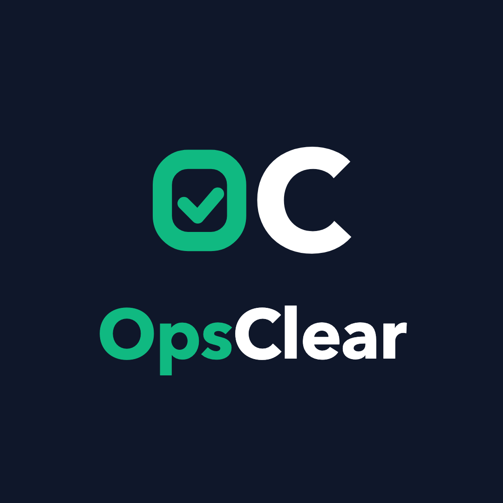
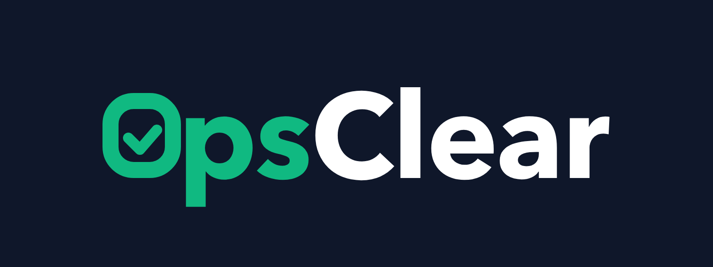

# OpsClear brand

Logos and icons for the app, social media and marketing. The mark is a checkbox **O** (a ticked
job) followed by a **C**: OpsClear = Operations + Clarity.

## Logos in use

| File | Preview | Use for |
|---|---|---|
| `opsclear-icon-dark` |  | Profile picture on every social platform, app favicon, Keycloak login favicon |
| `opsclear-logo-stacked` |  | Square logo with the name: post images, decks, Product Hunt |
| `opsclear-wordmark-dark` |  | Wide logo: cover banners, website header, email signature |

Each comes as `.png` (upload this one) and `.svg` (the master, scales to any size).

Favicons generated from `opsclear-icon-dark.png`:
- `frontend/public/favicon.png` (64×64) and `frontend/public/apple-touch-icon.png` (180×180)
- `keycloak/themes/opsclear/login/resources/img/favicon.ico` (64×64)

Where the wordmark appears in the product:
- App top bars (signed-in header, public pages, onboarding): `frontend/src/components/Logo.tsx`, the
  W1 style (checkbox O + "psClear") drawn as inline SVG plus Inter text, in `currentColor`
- Keycloak login pages: `keycloak/themes/opsclear/login/resources/img/wordmark.png`, the W4 style
  (green "Ops", navy "Clear"), cropped from `explorations/wordmarks/opsclear-wordmark-w4.png`

## Colours

| Name | Hex | Where |
|---|---|---|
| Green | `#10b981` | Checkbox O and "Ops" on dark backgrounds |
| Dark green | `#059669` | Green on light backgrounds (same as the app's primary) |
| Navy | `#0f172a` | Dark background, "Clear" on light backgrounds |
| White | `#ffffff` | "C" and "Clear" on dark backgrounds |

## Font

Avenir Next Bold (ships with macOS). The SVGs reference it by name, so on a machine without it the
text falls back to another font: share the PNGs, and convert text to outlines before printing.
Check the Avenir licence covers logo use before anything goes to print, or swap it for a free
font (Montserrat, Inter).

## Rules

- Keep the icon inside a centred circle with about 15% padding: platforms crop avatars round.
- Don't put the full "OpsClear" name in a small avatar; it's unreadable at 40 px.
- Don't recolour the checkbox O and the C the same colour on a dark background: the green/white
  split is what makes the mark.

## Explorations

`explorations/` holds the options considered before picking the logos above (avatars A–S,
wordmarks W1/W2/W4, icons X2/X3). Kept for reference; not in use. Avatar F was rejected because
it reads as the © symbol.
